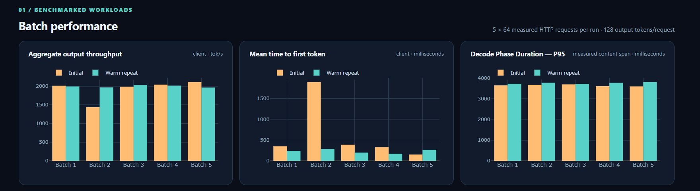

# Prompt2GPU

**LLM Inference Systems Lab — vLLM · GPU observability · prefill/decode · KV-cache performance**

Measurement-first AI infrastructure research using real NVIDIA Tesla T4 experiments: serving throughput, request latency, concurrency scaling, KV-cache pressure, and inference-runtime behavior.

**Author:** Santosh Kumar · **Latest release:** V1.1 · **GPU:** NVIDIA Tesla T4 · **Model:** Qwen2.5-1.5B-Instruct

## Explore the interactive V1.1 dashboard

[](https://santoshkumarsystems.github.io/Prompt2GPU/v1_1.html)

### **[▶ Launch the V1.1 Interactive Dashboard](https://santoshkumarsystems.github.io/Prompt2GPU/v1_1.html)**

*Click the screenshot or the link above to explore the working historical replay. No GPU, installation, or account required. The preview is a screenshot of the actual published measurements, not generated benchmark data.*

**What the experiments demonstrate**

- **Real concurrency workloads:** two measured C64 streaming runs, 320 requests each; mean aggregate output throughput of **1,917.87** and **1,994.69 tokens/s**, respectively, in the tested setup.
- **A first-token latency anomaly:** initial Batch 2 mean TTFT increased from **350.2 ms** (Batch 1) to **1,894.5 ms**. A Triton attention-kernel JIT warning occurred during Batch 2; temporal correlation is **not** proof of causation.
- **Live-captured metrics, replayed publicly:** Prometheus/Grafana observability from the real GPU runs, synchronized with request-level streaming measurements. Prefill P95 uses the exported server histogram; decode-phase P95 is derived from captured client streaming timings, not GPU-kernel duration.

**Explore the evidence:** [V1.1 findings](V1_1_FINDINGS.md) · [V1.1 raw measurements](results_v1_1/) · [Benchmark and telemetry methodology](observability/V1_1_CONCURRENCY.md)

**Earlier release:** [Launch V1.0 benchmark dashboard](https://santoshkumarsystems.github.io/Prompt2GPU/) · [V1.0 measured results](RESULTS.md)

> **Evidence policy:** Published benchmark values are grounded in committed raw CSV/JSON measurements. The public dashboards display recorded results; they do not run live inference or fabricate GPU samples.


## V1.1 — Streaming observability and Triton JIT investigation

[V1.1 interactive historical dashboard](https://santoshkumarsystems.github.io/Prompt2GPU/v1_1.html) — playback of **recorded** T4 metrics and client-side measurements; no live server or synthetic GPU data.


Measured follow-on C64/T4 experiments add client-observed TTFT/TPOT/conditional ITL, 12 exported Prometheus time series, and a corroborated runtime log warning during an anomalous batch. The repeat was more consistent without a new Triton JIT warning. This is correlation, **not** an isolated causal proof. See [V1.1 measured findings](V1_1_FINDINGS.md) and [`results_v1_1/`](results_v1_1/) for the original measured evidence. The existing V1.0 dashboard remains V1.0 and is not presented as V1.1 telemetry.

### V1.1 evidence provenance and Triton JIT annotation

**Real GPU measurements, offline replay — not a simulation of GPU inference.** We executed two concurrency-64 streaming experiments on a Google Colab NVIDIA Tesla T4 using Qwen2.5-1.5B-Instruct and vLLM 0.31.0. During those runs, Prometheus scraped vLLM server metrics every **5 seconds**, and **Grafana displayed those real metrics while the GPU experiment was running**. We then exported the recorded Prometheus time series and the client benchmark's request/batch CSV measurements. The public [V1.1 historical replay](https://santoshkumarsystems.github.io/Prompt2GPU/v1_1.html) renders **those same measured series** as interactive, Grafana-style panels using Plotly.js. It does **not** run Grafana, a GPU, or an inference server; the Play button only advances through saved timestamps. No GPU samples are invented or interpolated.

**What the Triton JIT annotation means.** Triton can compile a new attention-kernel specialization *just in time* when inference first encounters a configuration not covered by warm-up. The private vLLM engine log recorded `kernel_unified_attention` JIT compilation at **05:02:05 UTC** inside the initial run's slow **Batch 2**. Mean client TTFT increased from approximately **350 ms** in Batch 1 to **1,895 ms** in Batch 2, while mean TPOT remained near **28.4–28.7 ms**. On the warm-server repeat, no additional JIT warning appeared and the anomalous latency spike did not recur. **This is a plausible JIT-related latency explanation, not an isolated proof of causality**: compile duration was not independently measured and cache/warm-state effects were not controlled.

**Prefill vs Decode in V1.1:** The server-side **P95 prefill duration** comes from a recorded Prometheus 5-minute histogram query. The dashboard's **Decode phase — client proxy P95** is computed directly from each of the 640 real streaming request measurements: `(output_tokens − 1) × client TPOT`. This is the recorded first-to-last streamed output-content span, **not simulated data and not GPU decode-kernel execution time**. Each batch chart applies P95 to 64 request-level spans. These client and server boundaries are different; do not interpret their difference as a direct prefill/decode GPU timing comparison. We did not export the dedicated `vllm:request_decode_time_seconds` server histogram.

**Sampling boundary:** Client TTFT/TPOT comes from streaming HTTP observations; Grafana-style panels use recorded Prometheus gauges, one-minute token rates, and five-minute latency-histogram windows. Five-second scrapes may miss individual 4–6-second batches, so their plotted values must not be mistaken for per-batch measurements. The raw results and evidence checks are described in [`V1_1_FINDINGS.md`](V1_1_FINDINGS.md) and [`results_v1_1/`](results_v1_1/).

## View the published results — zero install

You do **not** need Python, CUDA, PyTorch, vLLM, or an NVIDIA GPU to explore either published dashboard.

- **Explore V1.1:** [Launch the interactive historical dashboard](https://santoshkumarsystems.github.io/Prompt2GPU/v1_1.html).
- Read the measured findings below or in [`RESULTS.md`](RESULTS.md).
- Open the [live Prompt2GPU V1.0 interactive dashboard](https://santoshkumarsystems.github.io/Prompt2GPU/) — no local setup required.
- View the committed charts in [`plots/`](plots/).
- Inspect the raw evidence in [`results/`](results/).

The committed dashboard already contains the real Google Colab / Tesla T4 V1.0 measurements. Rebuilding it is optional.

## V1.0 measured results

### Controlled single-request baseline

Same Tesla T4, model, FP16 precision, 69 input tokens, 128 forced output tokens, one warm-up run, and ten measured runs.

| Metric | HF / PyTorch | vLLM |
|---|---:|---:|
| Mean output throughput | 21.41 tok/s | 66.71 tok/s |
| Mean end-to-end latency | 6.007 s | 1.919 s |
| Measured throughput ratio | — | **3.12×** |

On this setup, vLLM produced about **3.12×** the single-request output-token throughput. The comparison is intentionally service-vs-library: vLLM timing includes HTTP request/response overhead while HF/PyTorch timing measures in-process generation.


### Concurrency scaling

Prefix caching was disabled. Each level used one warm-up batch and five measured batches.

| Concurrency | Mean aggregate tok/s | Mean latency | P95 latency |
|---:|---:|---:|---:|
| 1 | 66.63 | 1.921 s | 1.929 s |
| 2 | 130.25 | 1.957 s | 1.967 s |
| 4 | 249.88 | 2.040 s | 2.048 s |
| 8 | 461.44 | 2.208 s | 2.227 s |
| 16 | 796.64 | 2.546 s | 2.576 s |
| 32 | 1131.05 | 3.573 s | 3.609 s |
| 64 | 1645.93 | 4.856 s | 5.031 s |

Throughput continued rising through C=64, so V1.0 does **not** claim a hard saturation point. Scaling became progressively sublinear while latency increased.


### Context + KV-cache pressure

At concurrency 80, input context increased from 256 to 3800 tokens while generation remained fixed at 128 output tokens. vLLM reported a 297,472-token GPU KV cache, 16-token blocks, and prefix caching disabled.

| Input tokens | Mean aggregate tok/s | Mean latency | P95 | Peak KV usage | Peak waiting | Mean queue time |
|---:|---:|---:|---:|---:|---:|---:|
| 256 | 1076.03 | 9.270 s | 9.411 s | 10.3% | 56 | 1.063 s |
| 512 | 648.51 | 15.351 s | 15.590 s | 17.1% | 67 | 3.289 s |
| 1024 | 313.53 | 31.690 s | 32.411 s | 30.6% | 73 | 10.042 s |
| 2048 | 114.92 | 86.543 s | 88.851 s | 57.6% | 77 | 34.557 s |
| 3072 | 60.18 | 165.160 s | 169.786 s | 84.6% | 78 | 71.913 s |
| 3800 | 42.19 | 233.130 s | 242.314 s | 89.3% | 78 | 106.438 s |

Longer contexts increase both prefill work and KV-cache demand, so this is deliberately described as **context + KV-cache pressure**, not a KV-only causal experiment. Queueing is not explained by KV capacity alone.


For interpretation and limitations, read [`RESULTS.md`](RESULTS.md) and [`METHODOLOGY.md`](METHODOLOGY.md).

## Choose the path you actually need

### Path A — just explore Prompt2GPU

**Time:** immediate
**Download:** none
**NVIDIA GPU:** not required

Open the linked GitHub Pages dashboards or browse this README/results. No setup command is required.

### Path B — verify the published evidence

**Time:** usually a few seconds
**Download:** none
**NVIDIA GPU:** not required

```bash
make verify
```

This recomputes published summary values from the committed raw CSV measurements.

### Path C — rebuild charts/dashboard

**Time:** typically ~1–5 minutes, depending on network/cache
**Download:** lightweight Python plotting packages
**NVIDIA GPU:** not required

```bash
make setup-dashboard
make dashboard
```

No manual virtual-environment activation is required. The Makefile uses `.venv/bin/python3` directly.

### Path D — reproduce GPU benchmarks locally

**Time:** **~10–30 minutes on a fast connection; 30–60+ minutes on slower Wi-Fi**
**Download/disk:** **several GB**
**NVIDIA GPU + working driver:** required

First run the safe preflight:

```bash
make preflight-gpu
```

If no NVIDIA GPU/driver is detected, the GPU path **stops before downloading** PyTorch/CUDA/cuDNN/NCCL/vLLM and prints the lightweight alternatives.

If hardware is detected, run:

```bash
make setup-gpu
```

`make setup-gpu` prints the large-download/time warning again and requires you to type **YES** before installation begins. It never silently starts a multi-GB install.

> Different GPUs are expected to produce different performance numbers. Prompt2GPU reproduces the **methodology**, not identical cross-hardware throughput/latency.

## Common commands

```bash
make help
make verify
make serve
make setup-dashboard
make dashboard
make preflight-gpu
make setup-gpu
make audit
```

`make serve` serves the already-committed dashboard at `http://localhost:8000` and requires no third-party Python packages.

## GPU benchmark commands

After the optional GPU setup succeeds:

```bash
make hf-baseline
make start-vllm
make vllm-baseline
make concurrency
make kv-pressure
make stop-vllm
```

See [`RUNBOOK.md`](RUNBOOK.md) before rerunning benchmarks.

## Repository layout

```text
Prompt2GPU/
├── README.md
├── RESULTS.md
├── ROADMAP.md
├── METHODOLOGY.md
├── RUNBOOK.md
├── ENVIRONMENT.md
├── Makefile
├── requirements.txt             # lightweight dashboard only
├── requirements-dashboard.txt   # plotting dependencies
├── requirements-gpu.txt         # optional heavy benchmark dependencies
├── src/                         # benchmark/source code
├── scripts/
│   ├── verify_results.py
│   ├── build_dashboard.py
│   ├── preflight_gpu.py
│   ├── setup_gpu.py
│   └── audit_repo.py
├── results/                     # measured CSV/JSON evidence + checksums
├── plots/                       # committed README-ready charts
└── docs/
    ├── index.html               # committed interactive dashboard
    ├── architecture.svg
    ├── PYTHON_WALKTHROUGH.md
    └── data/                    # dashboard evidence copies
```

## New to Python?

Read [`docs/PYTHON_WALKTHROUGH.md`](docs/PYTHON_WALKTHROUGH.md). Every maintained Python file also includes:

```text
Author: Santosh Kumar
Project: Prompt2GPU
Version: 1.0
```

plus module/function documentation written to make the code understandable to readers new to Python.

## Data integrity

Verify result summaries:

```bash
make verify
```

Verify file checksums:

```bash
cd results
sha256sum -c SHA256SUMS.txt
```

Before any public push, run:

```bash
make audit
```

The pre-push audit checks source headers, dependency separation, personal/hard-coded paths, local artifacts, dashboard/result presence, raw-data recomputation, and obvious credential leakage.

## V2 and V3 roadmap

- **V2 — Multi-GPU inference systems:** tensor parallelism, NCCL collectives, AllReduce/AllGather/ReduceScatter, GPU topology, PCIe/NVLink effects, memory sharding, and scaling efficiency.
- **V3 — Production inference infrastructure:** Docker, Kubernetes GPU scheduling, replicas/load balancing, autoscaling, admission control, Prometheus/Grafana observability, SLOs, and failure/recovery experiments.

See [`ROADMAP.md`](ROADMAP.md) for the detailed plan.
