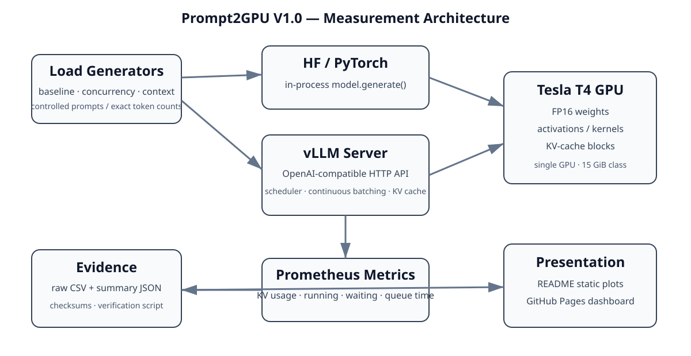
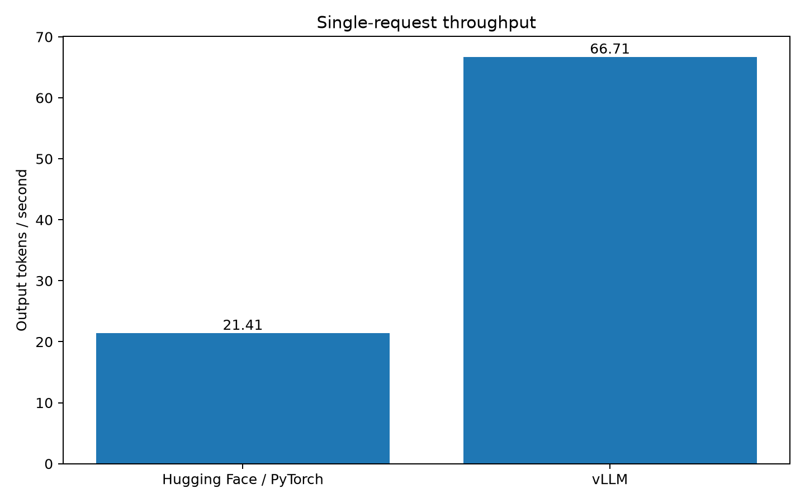
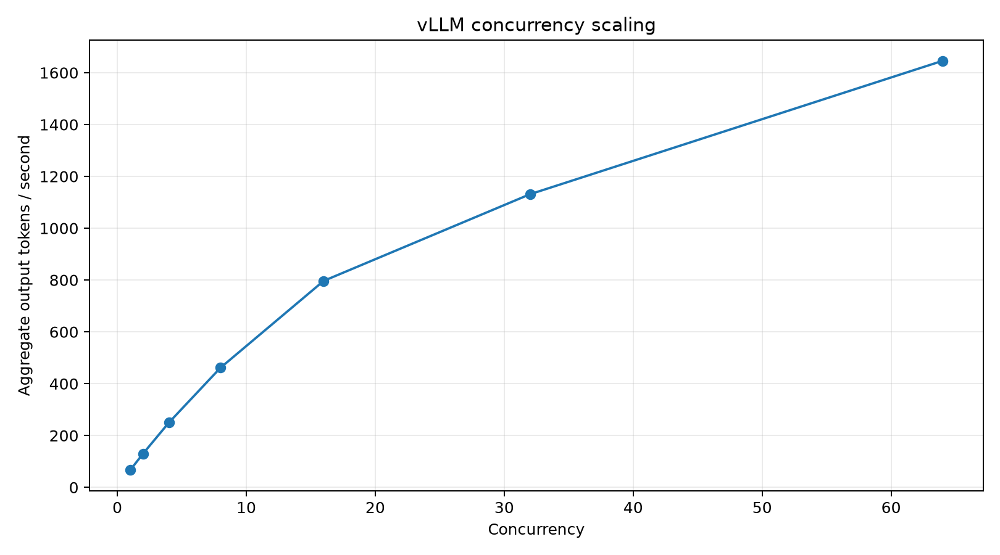
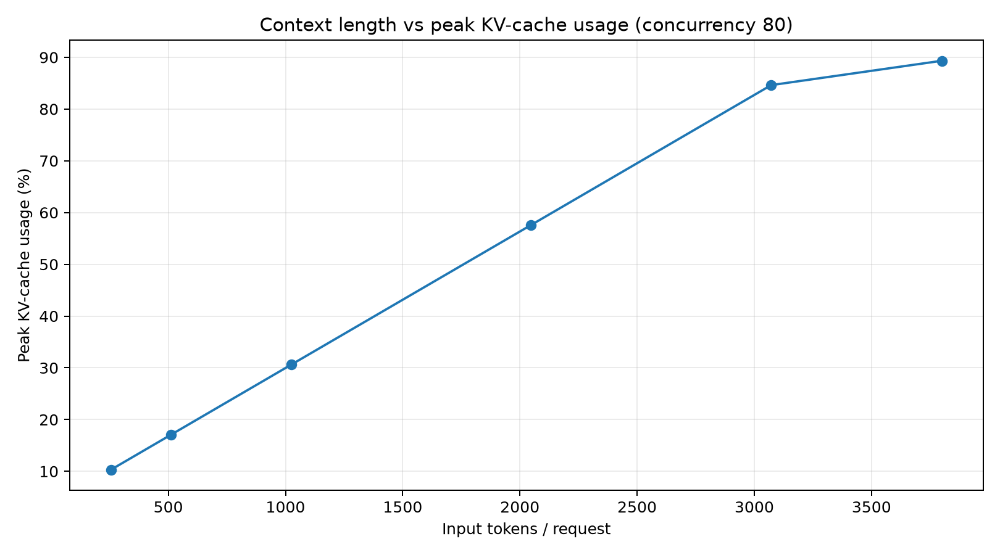

# Prompt2GPU

**LLM Inference Systems Lab — vLLM, concurrency, KV-cache pressure, and GPU performance**

**Author:** Santosh Kumar
**Version:** 1.0 (V1.0)
**Published V1.0 environment:** Google Colab · NVIDIA Tesla T4 · Qwen/Qwen2.5-1.5B-Instruct · FP16
**Live dashboard:** [Prompt2GPU V1.0 Interactive Dashboard](https://santoshkumarsystems.github.io/Prompt2GPU/)

Prompt2GPU is a measurement-first AI-infrastructure project. V1.0 compares a controlled Hugging Face/PyTorch generation baseline with vLLM on one Tesla T4, then measures concurrency scaling and context/KV-cache pressure.

> **Evidence policy:** every published benchmark number comes from committed raw CSV/JSON artifacts. The dashboard and plots are generated from those artifacts; benchmark values are not manually typed into chart code.



## View the published results — zero install

You do **not** need Python, CUDA, PyTorch, vLLM, or an NVIDIA GPU to inspect V1.0.

- Read the measured findings below or in [`RESULTS.md`](RESULTS.md).
- Open the [live Prompt2GPU V1.0 interactive dashboard](https://santoshkumarsystems.github.io/Prompt2GPU/) — no local setup required.
- View the committed charts in [`plots/`](plots/).
- Inspect the raw evidence in [`results/`](results/).

The committed dashboard already contains the real Google Colab / Tesla T4 V1.0 measurements. Rebuilding it is optional.

## V1.0 measured results

### Controlled single-request baseline

Same Tesla T4, model, FP16 precision, 69 input tokens, 128 forced output tokens, one warm-up run, and ten measured runs.

| Metric | HF / PyTorch | vLLM |
|---|---:|---:|
| Mean output throughput | 21.41 tok/s | 66.71 tok/s |
| Mean end-to-end latency | 6.007 s | 1.919 s |
| Measured throughput ratio | — | **3.12×** |

On this setup, vLLM produced about **3.12×** the single-request output-token throughput. The comparison is intentionally service-vs-library: vLLM timing includes HTTP request/response overhead while HF/PyTorch timing measures in-process generation.



### Concurrency scaling

Prefix caching was disabled. Each level used one warm-up batch and five measured batches.

| Concurrency | Mean aggregate tok/s | Mean latency | P95 latency |
|---:|---:|---:|---:|
| 1 | 66.63 | 1.921 s | 1.929 s |
| 2 | 130.25 | 1.957 s | 1.967 s |
| 4 | 249.88 | 2.040 s | 2.048 s |
| 8 | 461.44 | 2.208 s | 2.227 s |
| 16 | 796.64 | 2.546 s | 2.576 s |
| 32 | 1131.05 | 3.573 s | 3.609 s |
| 64 | 1645.93 | 4.856 s | 5.031 s |

Throughput continued rising through C=64, so V1.0 does **not** claim a hard saturation point. Scaling became progressively sublinear while latency increased.



### Context + KV-cache pressure

At concurrency 80, input context increased from 256 to 3800 tokens while generation remained fixed at 128 output tokens. vLLM reported a 297,472-token GPU KV cache, 16-token blocks, and prefix caching disabled.

| Input tokens | Mean aggregate tok/s | Mean latency | P95 | Peak KV usage | Peak waiting | Mean queue time |
|---:|---:|---:|---:|---:|---:|---:|
| 256 | 1076.03 | 9.270 s | 9.411 s | 10.3% | 56 | 1.063 s |
| 512 | 648.51 | 15.351 s | 15.590 s | 17.1% | 67 | 3.289 s |
| 1024 | 313.53 | 31.690 s | 32.411 s | 30.6% | 73 | 10.042 s |
| 2048 | 114.92 | 86.543 s | 88.851 s | 57.6% | 77 | 34.557 s |
| 3072 | 60.18 | 165.160 s | 169.786 s | 84.6% | 78 | 71.913 s |
| 3800 | 42.19 | 233.130 s | 242.314 s | 89.3% | 78 | 106.438 s |

Longer contexts increase both prefill work and KV-cache demand, so this is deliberately described as **context + KV-cache pressure**, not a KV-only causal experiment. Queueing is not explained by KV capacity alone.



For interpretation and limitations, read [`RESULTS.md`](RESULTS.md) and [`METHODOLOGY.md`](METHODOLOGY.md).

## Choose the path you actually need

### Path A — just explore Prompt2GPU

**Time:** immediate
**Download:** none
**NVIDIA GPU:** not required

Open `docs/index.html` or browse this README/results. No setup command is required.

### Path B — verify the published evidence

**Time:** usually a few seconds
**Download:** none
**NVIDIA GPU:** not required

```bash
make verify
```

This recomputes published summary values from the committed raw CSV measurements.

### Path C — rebuild charts/dashboard

**Time:** typically ~1–5 minutes, depending on network/cache
**Download:** lightweight Python plotting packages
**NVIDIA GPU:** not required

```bash
make setup-dashboard
make dashboard
```

No manual virtual-environment activation is required. The Makefile uses `.venv/bin/python3` directly.

### Path D — reproduce GPU benchmarks locally

**Time:** **~10–30 minutes on a fast connection; 30–60+ minutes on slower Wi-Fi**
**Download/disk:** **several GB**
**NVIDIA GPU + working driver:** required

First run the safe preflight:

```bash
make preflight-gpu
```

If no NVIDIA GPU/driver is detected, the GPU path **stops before downloading** PyTorch/CUDA/cuDNN/NCCL/vLLM and prints the lightweight alternatives.

If hardware is detected, run:

```bash
make setup-gpu
```

`make setup-gpu` prints the large-download/time warning again and requires you to type **YES** before installation begins. It never silently starts a multi-GB install.

> Different GPUs are expected to produce different performance numbers. Prompt2GPU reproduces the **methodology**, not identical cross-hardware throughput/latency.

## Common commands

```bash
make help
make verify
make serve
make setup-dashboard
make dashboard
make preflight-gpu
make setup-gpu
make audit
```

`make serve` serves the already-committed dashboard at `http://localhost:8000` and requires no third-party Python packages.

## GPU benchmark commands

After the optional GPU setup succeeds:

```bash
make hf-baseline
make start-vllm
make vllm-baseline
make concurrency
make kv-pressure
make stop-vllm
```

See [`RUNBOOK.md`](RUNBOOK.md) before rerunning benchmarks.

## Repository layout

```text
Prompt2GPU/
├── README.md
├── RESULTS.md
├── ROADMAP.md
├── METHODOLOGY.md
├── RUNBOOK.md
├── ENVIRONMENT.md
├── Makefile
├── requirements.txt             # lightweight dashboard only
├── requirements-dashboard.txt   # plotting dependencies
├── requirements-gpu.txt         # optional heavy benchmark dependencies
├── src/                         # benchmark/source code
├── scripts/
│   ├── verify_results.py
│   ├── build_dashboard.py
│   ├── preflight_gpu.py
│   ├── setup_gpu.py
│   └── audit_repo.py
├── results/                     # measured CSV/JSON evidence + checksums
├── plots/                       # committed README-ready charts
└── docs/
    ├── index.html               # committed interactive dashboard
    ├── architecture.svg
    ├── PYTHON_WALKTHROUGH.md
    └── data/                    # dashboard evidence copies
```

## New to Python?

Read [`docs/PYTHON_WALKTHROUGH.md`](docs/PYTHON_WALKTHROUGH.md). Every maintained Python file also includes:

```text
Author: Santosh Kumar
Project: Prompt2GPU
Version: 1.0
```

plus module/function documentation written to make the code understandable to readers new to Python.

## Data integrity

Verify result summaries:

```bash
make verify
```

Verify file checksums:

```bash
cd results
sha256sum -c SHA256SUMS.txt
```

Before any public push, run:

```bash
make audit
```

The pre-push audit checks source headers, dependency separation, personal/hard-coded paths, local artifacts, dashboard/result presence, raw-data recomputation, and obvious credential leakage.

## V2 and V3 roadmap

- **V2 — Multi-GPU inference systems:** tensor parallelism, NCCL collectives, AllReduce/AllGather/ReduceScatter, GPU topology, PCIe/NVLink effects, memory sharding, and scaling efficiency.
- **V3 — Production inference infrastructure:** Docker, Kubernetes GPU scheduling, replicas/load balancing, autoscaling, admission control, Prometheus/Grafana observability, SLOs, and failure/recovery experiments.

See [`ROADMAP.md`](ROADMAP.md) for the detailed plan.
